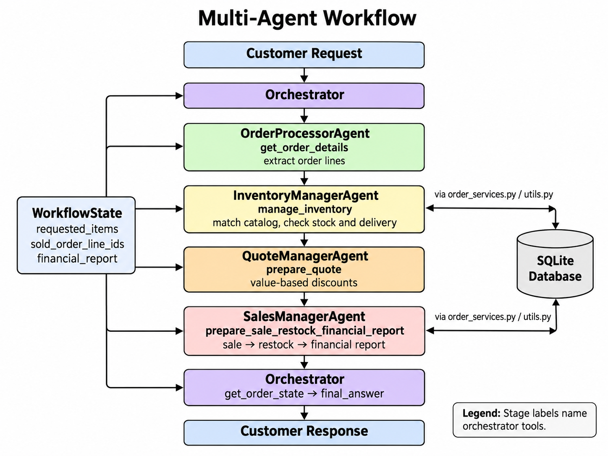
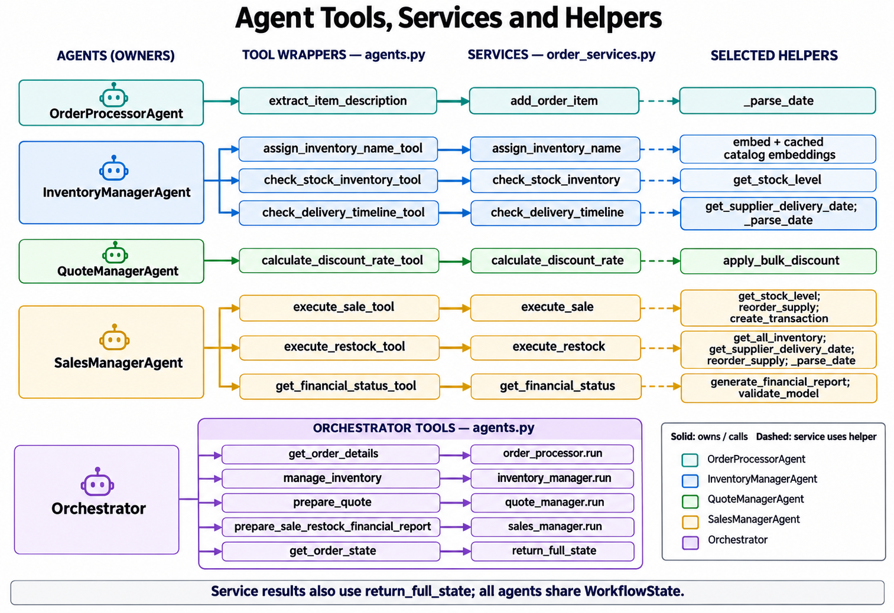

# Beaver's Choice Paper Company — Multi-Agent Inventory & Quoting System

<p align="center">
  
</p>

A multi-agent system that turns customer requests into inventory checks, quotes, and recorded sales. Built with [`smolagents`](https://github.com/huggingface/smolagents), Pydantic, and SQLite.

## The Challenge

Processing a customer request involves several steps:

- Read free-text requests, identify products, and extract quantities and dates
- Check stock, accounting for earlier sales
- Check whether supplier orders can cover shortages within the delivery deadline and available budget
- Calculate discounts from the value of fulfillable items
- Record each sale once in the ledger

## The Solution

Four specialized agents handle extraction, inventory, quoting, and sales. An orchestrator coordinates them through a shared `WorkflowState`:

- Each stage updates the same Pydantic `RequestedItem` objects in `WorkflowState`.
- BGE-M3 embeddings match customer descriptions against cached catalog embeddings.
- Agent tools call `order_services.py` for business logic and `utils.py` for database operations.

---

## Project origin

This project builds on Udacity’s Agentic AI capstone starter:

[Udacity starter project](https://github.com/udacity/agentic-ai-c4-exercises-demos/tree/main/project)

The starter supplies the datasets, catalog, database setup, and utility functions. The workflow here uses shared typed state, embedding-based matching, and one Sales Manager for sales, restocking, and reporting.

## Architecture


The agents and orchestrator are `ToolCallingAgent` instances:

*Figure 1. Order processing, shared state, and database access.*


| Agent | Responsibility | Tools |
|---|---|---|
| **Orchestrator** | Runs the workflow stages and writes the customer response from order state | `get_order_details`, `manage_inventory`, `prepare_quote`, `prepare_sale_restock_financial_report`, `get_order_state` |
| **Order Processor** | Extracts order lines as `RequestedItem` objects in shared state | `extract_item_description` |
| **Inventory Manager** | Matches catalog items, checks stock, and checks supplier delivery dates | `assign_inventory_name_tool`, `check_stock_inventory_tool`, `check_delivery_timeline_tool` |
| **Quote Manager** | Applies a discount based on the value of fulfillable items | `calculate_discount_rate_tool` |
| **Sales Manager** | Reorders shortfalls when feasible, executes sales, restocks low inventory, and generates the financial report | `execute_sale_tool`, `execute_restock_tool`, `get_financial_status_tool` |

### Agent tools, services and helper functions


*Figure 2. Agent-owned tool wrappers, order services, and the helper functions they call.*


Agents hold the application state in `self.workflow_state`, separate from the internal `state` dictionary used by smolagents. Order service functions receive the same `WorkflowState` instance as their `workflow_state` argument.

### Data flow

Each stage updates fields on the `RequestedItem` objects in `WorkflowState.requested_items`:

1. `order_line_id`, `item_description`, `requested_quantity`, `order_date`, `delivery_date` (Order Processor)
2. `matched_catalog_item`, `can_fulfill`, `shortage_quantity`, `supplier_order_feasible`, `supplier_delivery_date` (Inventory Manager)
3. `discount_rate` (Quote Manager)
4. `sale_completed` (Sales Manager)

The Sales Manager also handles restocking and financial reporting. The orchestrator calls `get_order_state` to read the final order state before writing the customer response.

## Business logic

### Inventory & reordering
- Stock levels are computed from the `transactions` table (stock orders minus sales) as of the request date via `get_stock_level`.
- Stock checks track remaining inventory across order lines for the same catalog item.
- If stock is insufficient, `check_delivery_timeline` uses `get_supplier_delivery_date` (lead time scales with quantity: same-day up to 10 units, up to 7 days for >1000 units) to decide whether a supplier reorder can arrive before the customer's delivery date.
- `reorder_supply` purchases the shortfall at 75% of the retail unit price (`SUPPLIER_PRICE_FACTOR = 0.75`), if cash as of the supplier arrival date covers the cost. Purchases are logged as `stock_orders` on that date.

### Quoting & discounts
`calculate_discount_rate` uses the total pre-discount value of lines fulfillable from stock or a feasible supplier reorder:

- $100 or more → 20%; $30 to under $100 → 10%; otherwise 0%.
- The same rate applies to all order lines.

### Sales execution
`execute_sale` checks and records each order line:
- Duplicate execution: `WorkflowState.sold_order_line_ids` tracks lines already sold in the current order.
- Stale shortfalls: before a supplier reorder, the shortfall is compared with the Inventory Manager's calculation; a mismatch stops the sale.
- Available stock: the sale is rejected if remaining stock cannot cover the line after any supplier reorder.
- Successful sales are recorded at `(1 − discount_rate) × unit_price × quantity` as `sales` transactions, dated on supplier arrival for supplier-dependent lines or on the request date otherwise.

The orchestrator reports which items were sold or rejected, includes requested delivery dates for sold items, and mentions any discount.

### Post-sale restocking & reporting
After attempting the sales, the Sales Manager runs restocking and reporting:
- `execute_restock` scans inventory as of the request date and reorders items below their configured minimum stock level, recording replenishment on the supplier arrival date.
- `get_financial_status` calls `generate_financial_report` and stores a validated `FinancialReport` in shared workflow state.

---

## Project structure

```
.
├── data/
│   ├── quote_requests.csv         # Historical customer inquiries used to seed the database
│   ├── quote_requests_sample.csv  # Sample requests used by the scenario runner
│   └── quotes.csv                 # Historical quotes used to seed the database
├── images/                        # Architecture and project images used in the README
├── src/
│   └── supply_chain_agents/
│       ├── __init__.py
│       ├── agents.py              # Specialized agents, tool wrappers, and Orchestrator
│       ├── config_logging.py      # Application logging configuration
│       ├── config.py              # Paths, DB engines, catalog data, workflow constants
│       ├── embeddings.py          # Embedding helper with lazy, cached model initialization
│       ├── inventory.py           # PAPER_CATALOG (names, categories, unit prices)
│       ├── main.py                # Entry point: builds WorkflowState and runs the scenarios
│       ├── models.py              # RequestedItem + FinancialReport Pydantic models
│       ├── order_services.py      # Inventory checks, discounts, sales, restocking, reporting
│       ├── utils.py               # Database, inventory, finance, date, and helper functions
│       └── workflow_state.py      # Shared WorkflowState passed to agents and services
├── tests/
│   └── test_e2e.py                # End-to-end workflow tests
├── .env                           # OPENAI_API_KEY (not committed)
├── .gitignore
├── pyproject.toml                 # Project metadata, dependencies, and build configuration
├── pytest.ini                     # Test discovery and e2e marker registration
└── README.md
```

### Database (SQLite via SQLAlchemy)

| Table | Purpose |
|---|---|
| `transactions` | Ledger of all `stock_orders` and `sales` (drives stock levels and cash balance) |
| `inventory` | Reference table of stocked items (~40% random coverage of the catalog, seeded) |
| `quote_requests` | Historical customer inquiries |
| `quotes` | Historical quotes with job type, order size, and event type metadata |

The company starts with a $50,000 cash balance and randomized initial stock.

---

## Setup & usage

### Requirements

- Python 3.11+
- An OpenAI API key (the system uses `gpt-4o-mini` via smolagents' `OpenAIServerModel`)

```bash
python -m pip install -e ".[dev]"
```

### Configuration

Create a `.env` file in the parent directory of the source folder:

```
OPENAI_API_KEY=sk-...
```

The model uses `temperature=0.0` and `parallel_tool_calls=False`. This reduces output variability and disables parallel tool calls, though responses can still vary between runs.

### Run

```bash
python -m supply_chain_agents.main
```

This will:
1. Initialize the database (`init_database`): tables, historical quotes, seeded inventory, starting cash.
2. Load and date-sort the test scenarios from `quote_requests_sample.csv`.
3. Process each request through the orchestrator, printing the response plus updated cash and inventory value after every order.
4. Print a final financial report and write all results to `test_results.csv`.

---

## Tests & coverage

`tests/test_e2e.py` contains 14 end-to-end tests using requests from `data/quote_requests_sample.csv`. They check catalog matches, quantities, fulfillment decisions, supplier feasibility, completed sales, and financial reports.

`tests/test_order_services.py` contains 27 tests for validation, catalog matching, shared stock allocation (including shortages across repeated catalog items), supplier arrival dates, discounts, sales, restocking, and financial reports.

### Scenarios covered

| Area | Scenarios |
|---|---|
| Inventory fulfillment | Fulfillment from available stock; replenishment of a shortage before completing a sale; allocating stock after an earlier line has a shortage |
| Mixed orders | Rejection of an unmatched item alongside supplier fulfillment of another item |
| Catalog matching | Underspecified requests; non-exact descriptions; product variants; dimensions; size and finish; distinct variants within one order |
| Rejection paths | Supplier delivery infeasibility; unmatched lines without aborting the workflow; shortages with infeasible replenishment; insufficient cash despite feasible supplier timing |
| Workflow state | Processing two orders consecutively and checking that their extracted item descriptions do not overlap |

### Test database and execution

The end-to-end suite uses `tests/test_munder_difflin.db`, separate from the application's `data/munder_difflin.db`. An autouse fixture calls `init_database()` before each test to restore the seeded data. The tests share one orchestrator, which resets workflow state for each order. Run the suites sequentially because the tests share a database.

The e2e tests are live integration tests: they require `OPENAI_API_KEY` and make paid model API calls. Both suites use the BGE-M3 embedding model, which may need downloading on the first run. The `e2e` marker selects the suite; registering the marker alone does not exclude it from a plain `pytest` run.

From the repository root, run the regular tests, e2e tests, or the complete suite:

```bash
python -m pytest -m "not e2e"
python -m pytest -m e2e
python -m pytest
```

### Coverage

The full-suite command below generates a terminal report showing missing lines and an HTML report:

```bash
python -m pytest --cov=supply_chain_agents --cov-config=pyproject.toml --cov-report=term-missing --cov-report=html
```

Open `htmlcov/index.html` and select a module to inspect its missed executable lines. The report omits `supply_chain_agents/main.py`; `configure_logging()` is excluded using `# pragma: no cover`.

**Test results:** 40 of 41 tests pass. One e2e test fails because `"high-quality glossy paper"` is matched to `"A4 glossy paper"` instead of being rejected.

**Coverage:** The latest full-suite coverage report is 95% (472 of 499 statements); the module breakdown below is from that report.

| Module | Statements | Missed | Coverage |
|---|---:|---:|---:|
| `agents.py` | 114 | 3 | 97% |
| `config.py` | 15 | 0 | 100% |
| `config_logging.py` | 5 | 0 | 100% |
| `embeddings.py` | 9 | 0 | 100% |
| `inventory.py` | 1 | 0 | 100% |
| `models.py` | 21 | 0 | 100% |
| `order_services.py` | 167 | 2 | 99% |
| `utils.py` | 153 | 22 | 86% |
| `workflow_state.py` | 14 | 0 | 100% |
| **Total** | **499** | **27** | **95%** |


The end-to-end tests mainly check workflow state, with limited assertions on ledger and financial calculations; `tests/test_order_services.py` covers those service-level behaviors directly.

---

## Design decisions

- Shared state: stages update the same `RequestedItem` objects instead of passing JSON/schema text between prompts.
- Matching and transactions: Python functions handle catalog matching, pricing, stock calculations, and ledger writes. Catalog embeddings are cached.
- Sales ownership: one agent handles sales, restocking, and reporting, reducing handoffs.
- Validation: checks cover stage order, duplicate sales, changed shortfalls, and cash available for supplier purchases.
- Point-in-time accounting: Stock checks and financial reports use the request date; supplier purchases and dependent sales use the supplier arrival date.

## Possible improvements (WIP)

- Use stricter catalog matching to avoid false-positive matches; when a request is rejected or cannot be matched confidently, suggest the closest catalog products available to the customer.
